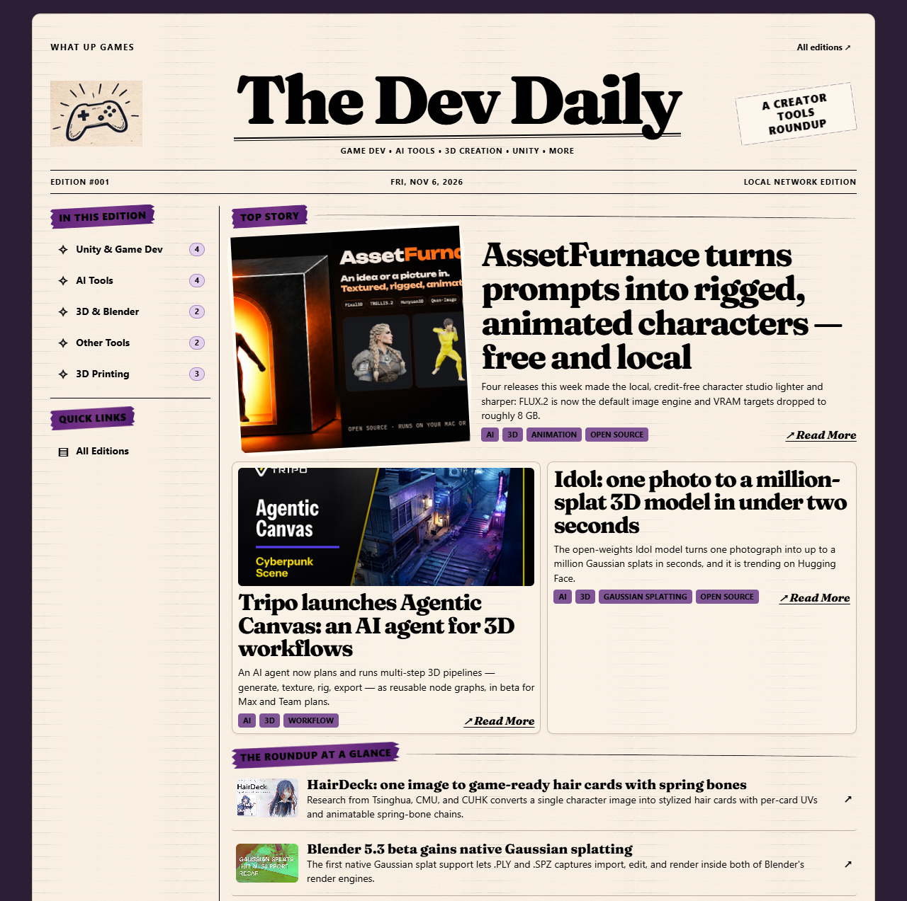

# The Dev Daily

A local-network newspaper for AI-curated game development and creative tools
news, published by **What Up Games**. Your briefing AI writes one Markdown
file per edition; a one-command build turns each file into a cute newspaper
of static pages you can read in a desktop browser or on your phone — no
database, no CMS, no server-side code.

- **Writing contract:** [`EDITION_TEMPLATE.md`](EDITION_TEMPLATE.md) — the exact format your briefing AI must produce
- One bundled sample issue (`editions/2026-11-06.md`) so the paper isn't empty on first run; delete it once your own first edition lands

## What it looks like

The front page of the bundled sample edition — lead story, secondary cards,
and the Roundup at a Glance index:



---

## Quick start (Windows, local testing)

Requires Node.js 20+ (22 recommended).

```powershell
# one-time setup (from your clone of this repo)
cd path\to\thedevdaily
npm install

# build the paper into .\dist (repeat after each new edition)
npm run build

# look at it — either the built-in preview (renders live, no build needed)…
npm start
# …or any static file server pointed at .\dist
```

Open <http://127.0.0.1:8787/> — you'll see the bundled sample issue.

Useful variants:

```powershell
node server.js --port 9000                          # preview: different port
node server.js --editions D:\briefings\editions     # preview: different content folder
node server.js --host 0.0.0.0                       # preview: reachable from the home LAN
node build.js --out D:\www\devdaily                 # build: different output folder
node build.js --site-base TheDevDaily               # build: hosted in a subfolder (example.com/TheDevDaily/)
```

Settings come from CLI flags first, then environment variables
(`DEVDAILY_EDITIONS`, `DEVDAILY_HOST`, `DEVDAILY_PORT`,
`DEVDAILY_IMAGES_DIRNAME`, `DEVDAILY_OUT`), then defaults (`./editions`,
`127.0.0.1`, `8787`, `./dist`).

## Home server (Linux container)

The site is static: build `dist/` on the host, and the container is just
nginx serving that folder as a **read-only volume**. The image holds no Node
and no content, so rebuilding the paper never touches the running server.

```bash
# on the server: build the static pages, then start nginx
npm run build
docker compose up -d --build
# or without compose:
docker build -t devdaily .
docker run -d --name devdaily --restart unless-stopped \
  -p 8787:80 \
  -v /home/you/devdaily/dist:/usr/share/nginx/html:ro \
  devdaily
```

- Republishing an edition is a host-side `npm run build` away — no container
  rebuild or restart. The build swaps `dist/` into place atomically, so
  nginx never serves a half-written site.
- Health check: `curl http://localhost:8787/healthz` → `ok`.
- Logs: `docker logs devdaily`.

### Make it available on the home LAN (no public exposure)

The paper should only ever be reachable from your own network. Never port
forward it, never put it behind a public tunnel or host.

**Linux server (ufw), scoped to your subnet** — replace `192.168.1.0/24`
with your actual subnet:

```bash
sudo ufw allow from 192.168.1.0/24 to any port 8787 proto tcp comment 'Dev Daily LAN'
```

Docker publishes ports through its own firewall chain, so also make sure the
port isn't bounced straight through to the world: publish to your LAN IP or
restrict with DOCKER-USER if you need finer control:

```bash
# bind the publish to the server's LAN IP only
docker run -d -p 192.168.1.10:8787:80 -v /home/you/devdaily/dist:/usr/share/nginx/html:ro devdaily
```

**Windows host (if testing LAN from Windows):**

```powershell
netsh advfirewall firewall add rule name="The Dev Daily (LAN only)" `
  dir=in action=allow protocol=TCP localport=8787 remoteip=localsubnet profile=private
```

Find the server's address with `ipconfig` (Windows) or `ip addr` (Linux),
e.g. `http://192.168.1.10:8787/`.

### Reading on your phone

1. Connect the phone to the same Wi-Fi/network as the server.
2. Open `http://<server-lan-ip>:8787/` in the phone browser.
3. Verify: the front page stacks into one column with a collapsible
   **Table of Contents**, articles read in one column, and the archive opens
   from the toolbar. Add it to the home screen for a newspaper-style icon.

If the page doesn't load: confirm both devices are on the same subnet, the
firewall rule above exists, and the server printed its LAN URL at startup.

---

## Publishing an edition (the briefing AI's workflow)

The content folder is the source of truth. The AI that researches and writes
the briefing needs **write** access to it; everything else only reads. When
the finished file lands, `npm run build` publishes it: every page — front
pages, section pages, articles, archive — regenerates into `dist/` in a
moment. (`npm start` is a live preview that renders per request, handy for
eyeballing an edition before building.)

Where to write:

| Environment   | Editions folder                                  |
| ------------- | ------------------------------------------------ |
| Windows local | `<your clone>\editions\` (or pass `--editions`)  |
| Container     | whatever you mounted at `/data/editions`          |

File layout per issue:

```
editions/
  2026-11-06.md                  <- the issue (frontmatter + stories)
  images/2026-11-06/             <- that issue's images
    assetfurnace.webp
```

Rules (full contract in `EDITION_TEMPLATE.md`):

- Filename must be `YYYY-MM-DD.md` and must equal the `edition_date` in the
  frontmatter; `coverage_start` must not be after `coverage_end`.
- One H1 (issue heading), one H2 per story, H3s inside a story are its
  article sections. Labeled fields: `Section`, `Featured`, `News date`,
  `Availability`, `Tags`, `Summary`.
- Images go in `editions/images/YYYY-MM-DD/` referenced relatively
  (`./images/YYYY-MM-DD/name.webp`) — or the image line may hotlink a direct
  `https://` URL to the source's announcement graphic. Raw HTML is ignored
  (rendered as text), and only `http(s)` links, local images inside the
  images tree, and `https://` images are served.

**Publish atomically — write to a temp name, rename into place after the
images are ready**, so a refresh never catches a half-published issue:

```powershell
# the briefing AI stages the issue first
$issue = "D:\briefings\staging\2026-11-07.md"
$img   = "D:\briefings\staging\images\2026-11-07"
$editions = "path\to\thedevdaily\editions"

# 1. copy images into place
New-Item -ItemType Directory -Force "$editions\images\2026-11-07" | Out-Null
Copy-Item "$img\*" "$editions\images\2026-11-07\"

# 2. then rename the finished issue into the content folder
Move-Item -Force $issue "$editions\2026-11-07.md"
```

Then run `npm run build` — the front page and archive pick up the new
edition, and the build output is swapped in atomically so a running server
never catches a half-written site. If a file is malformed it is never
silently dropped: the build warns about it, the archive lists the filename
and the reason, and every other issue stays readable.

### Example researcher prompt (for your AI)

The repo ships a complete, ready-to-adapt researcher prompt:
[`skills/research-daily-edition/SKILL.md`](skills/research-daily-edition/SKILL.md).
It turns an AI agent into the end-to-end journalist — research the last 24
hours across three beats (AI, game development, 3D printing), verify primary
sources, download images, and publish the edition atomically.

To use it:

1. Copy the file into your AI tool's skills/prompts location, or paste it as
   the system prompt for a scheduled run.
2. Fill in the three placeholders it lists (a table at the top of the file):
   `{{PROJECT_ROOT}}` (your clone's path), `{{APP_URL}}` (where the app is
   served), and `{{LOCAL_TIMEZONE}}` (your IANA timezone).
3. Run it daily — or on whatever cadence you like; the paper skips quiet days
   on its own.

Everything the AI needs to know about the file format lives in
[`EDITION_TEMPLATE.md`](EDITION_TEMPLATE.md), which the prompt re-reads on
every run.

## Security model

- Treats AI Markdown as **content**: raw HTML is escaped, `javascript:` /
  `data:` / other dangerous link schemes are stripped, and images are served
  two ways only — local files resolving **inside the configured images tree**
  (after path and symlink resolution, extension allowlist), or **hotlinked
  `https://` URLs** from the source pages. Local copies are preferred: a
  hotlinked image can break when the source rate-limits or moves it.
- Only files under `editions/images/` are copied into `dist/media/`; path
  traversal and symlink escapes are rejected at build time, and the served
  site contains no request-time code at all.
- The live preview (`npm start`) binds to `127.0.0.1` by default; LAN
  exposure is opt-in and firewall-scoped.
- No database, no cookies, no accounts. UI assets (fonts, artwork) are bundled
  locally — the only external requests a reader's browser makes are for
  hotlinked `https://` images that an edition itself points at
  (OFL license in `server/static/fonts/OFL.txt`).

## Tests

```powershell
npm test
```

Covers parsing (wrapped summaries, code fences, featured selection, duplicate
slugs), URL identity, archive behavior, broken-file isolation, the security
rules above, and the static build (pages, section pages, media copy,
stale-output cleaning).

## Project structure

```
build.js                static site builder (npm run build)
server.js               live preview server (npm start; renders per request)
server/                 shared rendering modules + the preview app
  parsing.js            frontmatter + structural Markdown parsing
  rendering.js          Markdown rendering, URL schemes, media resolution
  library.js            content-folder scanner with mtime cache
  routes.js             page view-models + /media + /healthz
  app.js                Express app factory
  templates/            Nunjucks templates (front, article, archive, notices)
  static/css/paper.css  all styling; design tokens in :root
  static/fonts/         bundled Fraunces (OFL) + license
  static/img/           newspaper artwork (controller, coffee, paper grain)
editions/               your content (bundled sample 2026-11-06 included)
dist/                   the built site — what nginx (or any server) serves
tests/                  node:test suite
nginx.conf              container nginx config (static site, 404 page)
Dockerfile              nginx image for the home server
docker-compose.yml      one-command deployment
```
