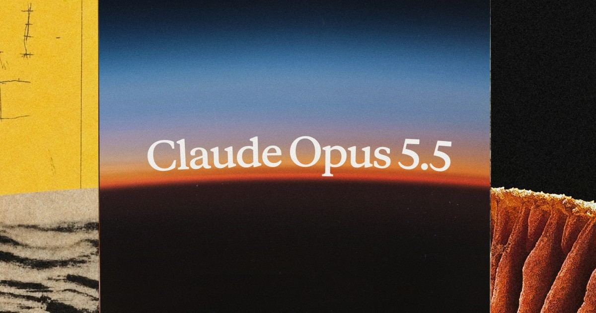

# The Dev Daily

## Anthropic ships the Claude 5.5 family: Opus, Sonnet, and Haiku

**Section:** AI Tools
**Featured:** true
**News date:** 2026-11-07
**Availability:** Shipped
**Tags:** AI, Claude, Coding, Agents

**Summary:** Anthropic's new 5.5 family promises Fable-level work from Opus at roughly 40% less runtime cost, with a much cheaper small model for speed-sensitive tooling.

*Image credit: [Anthropic — Introducing Claude Opus 5.5](https://www.anthropic.com/news/claude-opus-5-5).*

### About the tool

Claude is Anthropic's frontier model family, used through Claude Code, the Claude apps, and the API — and as the engine inside third-party coding agents and AI tools.

### What changed

Anthropic's newsroom now lists three 5.5-series announcements dated November 7: Opus 5.5, Sonnet 5.5, and Haiku 5.5. Opus 5.5, the family's first release, is claimed to perform at the level of Claude Fable 5.1 on most work while costing 40% less to run. Pricing is $4 and $20 per million input/output tokens (20% under Opus 5), with cache reads at $0.20 per million (60% less) — the dominant cost in agentic sessions — and output more than 30% faster. A Fast mode in Claude Code and the Claude Platform runs up to 2.5x faster at $8/$40 per million. Anthropic's examples: auditing and fixing a 200,000-line codebase in under three hours where Opus 5 took over 20 hours with 2.5x the tokens, and a FrontierCode agent score of 54.6%, above the 53.3% it reports for OpenAI's GPT-6 Astra at about a fifth of the cost. Haiku 5.5 is positioned as the fastest, most capable small model at reduced cost.

### Why it matters

Pricing, not just intelligence, is the story: cache-heavy agent work — the default mode of Claude Code, Cursor-style tools, and build pipelines — gets frontier-level output at a fraction of the token bill. For tutorial creators, a new model family is the reliable "what changed, what to re-test" episode, and this one moves both quality and cost in the right direction.

### Try or teach

Re-run a real Claude Code task on Opus 5.5 at default effort and log time, tokens, and cost against Opus 5 — Anthropic's numbers predict roughly a fifth of the cost on agentic workloads. Teach viewers how cache reads drive that math.

### Limitations

Benchmarks and examples come from Anthropic's own announcements, not independent runs; the pages were already live ahead of their November 7 dateline when this edition was researched. Sonnet 5.5's specifics were not reviewed in depth here.

### Sources

- [Anthropic — Introducing Claude Opus 5.5](https://www.anthropic.com/news/claude-opus-5-5)
- [Anthropic — Introducing Claude Haiku 5.5](https://www.anthropic.com/news/claude-haiku-5-5)
- [Anthropic — Introducing Claude Sonnet 5.5](https://www.anthropic.com/news/claude-sonnet-5-5)
