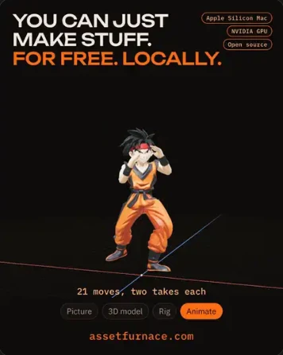
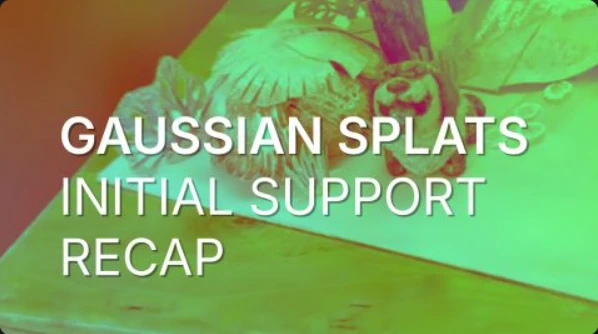
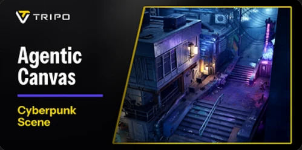

# The Dev Daily

## AssetFurnace makes animated characters locally

**Section:** Unity & Game Dev
**Featured:** true
**News date:** 2026-11-03
**Availability:** Shipped
**Tags:** AI, 3D, Animation, Open Source

**Summary:** Turn a text prompt or picture into a textured, rigged, animated GLB locally. Recent releases add FLUX.2 and lower memory requirements.

*Image credit: AssetFurnace project documentation, as shown in the supplied briefing.*

### About the tool

AssetFurnace is a local studio for generating and animating characters with open models.

### What changed

Releases from October 31 through November 3 made FLUX.2 the default image engine and added multi-view input and inpainting.

### Why it matters

A prototype character can move from a prompt to a rigged asset without leaving the tool.

### Try or teach

Generate a character, apply a motion preset, and import the GLB into a Unity test project.

### Limitations

Memory and quality claims in the briefing came from the project maintainer.

### Sources

- [AssetFurnace website](https://assetfurnace.com/)

## Blender 5.3 beta adds Gaussian splatting

**Section:** 3D & Blender
**Featured:** false
**News date:** 2026-10-30
**Availability:** Beta
**Tags:** Blender, 3D, Rendering

**Summary:** Initial support brings PLY and SPZ splat import, editing, and rendering into Blender.

*Image credit: Blender development blog, as shown in the supplied briefing.*

### About the tool

Blender is a 3D creation tool used for modeling, animation, and rendering.

### What changed

Cycles and EEVEE can render splats, with different approaches to drawing them.

### Why it matters

A scanned environment can serve as a reference in the same scene where you model and render.

### Try or teach

Import a phone capture and use it as a reference for a clean mesh.

### Limitations

Editing and relighting support are early-stage.

### Sources

- [Blender development blog](https://code.blender.org/)
- [Blender downloads](https://www.blender.org/download/)

## Tripo launches Agentic Canvas

**Section:** AI Tools
**Featured:** false
**News date:** 2026-11-02
**Availability:** Beta
**Tags:** AI, 3D, Workflow

**Summary:** An AI agent chains 3D generation, texturing, rigging, and export into reusable node graphs.

*Image credit: Tripo announcement / PR Newswire, as shown in the supplied briefing.*

### About the tool

Tripo generates 3D models from text and images. Agentic Canvas adds an agent that builds and runs reusable workflows.

### What changed

The briefing lists an October 29 announcement and a November 2 press release. The beta lets you save a graph and reuse it for batches of assets.

### Why it matters

You can apply the same generation steps to several props in a prototype.

### Try or teach

Build a graph for one prop, then rerun it with a different input and compare the results.

### Limitations

The briefing describes a beta rollout for Max and Team plans.

### Sources

- [Tripo website](https://www.tripo3d.ai/)
